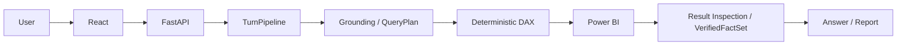

# PowerBIAgent

用自然语言查询 Power BI 语义模型，并从经过验证的事实生成固定模板 HTML 报表。

PowerBIAgent 面向不熟悉 DAX 的业务用户，提供 React 对话界面和 FastAPI 后端。语言模型理解问题，确定性运行时完成语义落地、DAX 构造、查询和结果验证；回答与报表共享 `VerifiedFactSet`。可连接本机 Power BI Desktop，也可通过 Fabric IQ 查询云端模型。

[](https://github.com/Strange-Men/PowerBIAgent/actions/workflows/ci.yml)


## Why PowerBIAgent

业务人员知道想回答的问题，却不一定知道模型中的表、字段、指标或 DAX 写法。PowerBIAgent 将自然语言意图与当前模型的真实结构、成员和权限绑定，帮助用户问数、追问和生成报表。

产品的重点是答案可验证：对象含糊时先澄清，结果不完整时拒绝把部分结果当作完整结论。语言模型不编写执行用 DAX，也不计算业务数值；历史对话方便恢复工作，但不会成为新的事实来源。普通聊天可以直接进行，涉及组织业务事实时才进入正式查询链。

## Key Features

- **自然语言问数**：支持单值、实体列表、分组、排名、成员集合、筛选聚合、趋势与有界趋势八种查询形状。
- **确定性事实链**：用运行时 schema 和成员验证语义对象，由确定性构造器生成受限 DAX，结果检查后进入 `VerifiedFactSet`。
- **两种 Power BI 接入**：Local Desktop 经只读 Modeling MCP 连接当前模型；Fabric IQ Cloud 使用 Microsoft 登录和当前资源权限。
- **固定模板报表**：提供“简易销售分析模板”和“专业销售经营分析模板”，共享已验证事实，生成可查看、下载的静态 HTML。
- **多轮分析与恢复**：支持兼容的追问、模型切换隔离，以及使用 SQLite 的历史、搜索、归档、恢复和资源删除。
- **模型与模板目录**：由后端提供模型和适配当前模型的模板；用户显式选择，失效或不匹配时明确提示。
- **可控语言模型选择**：支持 DeepSeek、Kimi K2.6 的公开 profile 与离线 Mock；每轮固定所选模型，失败不自动切换 Provider。
- **离线验证**：Mock、Synthetic 和 Golden 用例覆盖事实链及权限边界，真实 Desktop 与 Cloud 验收独立记录。

M6.5.2 Web / SSO Productization FINAL COMPLETE（按本提交自身 CI/Audit/clean/shutdown 生效）：Microsoft 登录后从输入框“+”浏览工作区、语义模型与报表；历史和报表支持重登恢复。语言仍位于“设置 → 常规 → 语言”，已有事实仅重投影，见 [M6.5.2](docs/milestones/m6/m6_5_2_web_sso_productization.md)。

## Architecture



LLM 负责理解和表达；运行时负责证明对象、执行状态、查询结果和事实。Power BI 访问统一经过 ToolGateway 与 Adapter，Local/Cloud 替换接入层，保留同一上层事实链。报表使用固定模板 Renderer，不让 LLM 临时生成 HTML、脚本或业务计算逻辑。详细职责见[项目章程](PROJECT_CHARTER.md)和[架构决策](docs/adr/README.md)。

## Runtime Modes

| 模式 | Power BI 来源 | 身份与配置 | 适用场景 |
|---|---|---|---|
| Mock | 离线合成模型 | `LLM_MODE=mock`、`POWERBI_MODE=mock` | 开发与自动化测试；不需要 API Key 或 Desktop |
| Local Desktop | 当前打开的 Desktop 模型 | `IDENTITY_MODE=LOCAL_DEV`、`POWERBI_MODE=local_mcp`，已配置真实 LLM | Windows 本地只读分析；显式选择目标模型 |
| Fabric IQ Cloud | 已授权 Workspace 中的云端模型 | `IDENTITY_MODE=ENTRA_BFF`、`POWERBI_MODE=fabric_iq`，operator 配置 | Microsoft 登录、资源权限和应用策略约束下的云端问数与报表 |

Local Desktop 使用本机模型；Fabric IQ Cloud 使用当前登录 principal 的访问权限。Microsoft 登录本身不自动授予应用执行、外部 LLM 披露或业务持久化权限。云端查询只走 Fabric IQ，Fabric REST 负责目录与 metadata。旧 `remote_mcp` 模式当前不可用。

## Quick Start

### Prerequisites

- Python **3.11**；仓库提供名为 `PBIAgent` 的 Conda 环境。
- Node.js **24 LTS** 与 npm，用于 React/Vite 前端；Local MCP 还需要 npm/npx。
- Local Desktop 需要 Windows、Power BI Desktop、已打开的目标模型，以及已配置的真实 LLM Key。
- Mock 模式无需 Microsoft 账号、API Key 或 Power BI Desktop。

### Install

在仓库根目录执行：

```powershell
conda env create -f environment.yml
conda activate PBIAgent
python -m pip install -e ".[dev]"
```

配置项见 [.env.example](.env.example)。环境变量覆盖本地配置；真实 Key 只在本地安全配置，不提交或发送到聊天。首次使用、没有已有配置时可复制模板：

```powershell
Copy-Item .env.example .env
```

### Mock backend

在已激活的 Python 环境中启动：

```powershell
$env:IDENTITY_MODE = 'LOCAL_DEV'
$env:LLM_MODE = 'mock'
$env:POWERBI_MODE = 'mock'
$env:PERSISTENCE_BACKEND = 'memory'
$env:REQUEST_TIMEOUT_SECONDS = '180'
python -m uvicorn backend.app.main:app --host 127.0.0.1 --port 8000
```

Mock 返回合成数据，适合先熟悉对话与模板流程。`memory` 只保留进程内状态；需要重启恢复、历史或搜索时使用 `PERSISTENCE_BACKEND=sqlite`。存储职责见[持久化 ADR](docs/adr/ADR-012_local_persistence_architecture.md)。

### Frontend

另开终端，在仓库根目录执行：

```powershell
cd frontend
npm ci
npm run dev
```

打开 **http://localhost:5173/**。Vite 将 `/auth`、`/api`、`/health` 代理到后端。开发模式下可通过 **http://127.0.0.1:8000/docs** 查看 OpenAPI；`DEBUG=false` 时关闭 Swagger/ReDoc。

### Local Desktop

先在 Desktop 打开模型，并安全配置 `DEEPSEEK_API_KEY`。在仓库根目录、已激活环境中启动：

```powershell
$env:IDENTITY_MODE = 'LOCAL_DEV'
$env:LLM_MODE = 'deepseek'
$env:LLM_DEFAULT_PROFILE = 'deepseek'
$env:POWERBI_MODE = 'local_mcp'
$env:POWERBI_LOCAL_MCP_READONLY = 'true'
$env:PERSISTENCE_BACKEND = 'sqlite'
$env:MAX_TOOL_CALLS = '8'
$env:REQUEST_TIMEOUT_SECONDS = '180'
python -m uvicorn backend.app.main:app --host 127.0.0.1 --port 8000
```

前端启动方式相同。进入“数据模型”菜单选择当前 Desktop 模型，在“AI 模型”菜单选择已配置的 profile，再提交问题。生成报表前显式选择适配当前模型的模板。若目录仍显示 Mock 销售模型，先确认后端模式与当前终端配置。

Local MCP 实机协议基线为 `@microsoft/powerbi-modeling-mcp@0.5.0-beta.12`；模型目录会验证连接和 schema。Desktop 或后端重启后旧模型 key 可能失效，需要刷新目录并重新选择。Kimi K2.6 使用用户自有的 OpenAI-compatible gateway，配置项见模板；不提供预设真实 host 或 Key。更多前置条件与恢复方式见[Power BI MCP/API 契约](docs/04_powerbi_mcp_and_api_contracts.md)。

### Fabric IQ Cloud

Cloud 需要 operator 完成 Entra 同源登录、应用策略与隔离存储配置。Normal Product 使用 `FABRIC_TEST_MODE=false`，无需 `FABRIC_TEST_ALLOWLIST`；目录与选择由当前 Microsoft principal 的精确资源访问证明。Test Mode 继续保留 allowlist。外部 LLM 披露和业务留存分别受 `ALLOW_EXTERNAL_LLM_DISCLOSURE` / `ALLOW_BUSINESS_PERSISTENCE` 控制，默认关闭。浏览器 Origin 与 callback 同源；登录后在输入框“+”浏览 Workspace → Semantic Model / Report，显式选择才加载 schema。

完整边界见[Cloud ADR](docs/adr/ADR-020_fabric_iq_cloud_consumption_and_catalog_authority.md)、[Auth 文档](docs/milestones/m6/m6_1_entra_identity_login_session.md)和[开发交接](docs/09_context_handoff.md)。登录或授权失败时，先区分应用策略与 Microsoft 资源访问，不直接扩大 Workspace 权限。

### M6.5.2_FIX2 — Persistence Readiness + Cloud UX Layout Closure

Cloud Normal Product（ENTRA_BFF + fabric_iq + ALLOW_BUSINESS_PERSISTENCE=true +
SQLite）在 startup 只读检查 schema revision、正式资源表与文件系统可用性；不执行迁移或
`create_all`。`/health` 分开返回 `configuration_ready` 与 `persistence_ready`，登录后的
Cloud status 保留安全 revision diagnostics。旧/空 DB 返回 `PERSISTENCE_SCHEMA_OUTDATED`，
在 LLM、ExecuteQuery、Facts、Memory 前拒绝业务执行。完成迁移后须重启 backend。

部署/operator 顺序：停止 workers → 备份现有 DB → 使用相同工作目录和 Settings 环境执行
`python scripts/prepare_persistence.py --upgrade` → 验证 current=head → backend start →
health ready。只检查可省略 `--upgrade`；helper 非就绪返回非零。目标完全来自
`Settings.persistence_database_path`，支持 `PERSISTENCE_DATABASE_PATH`，不使用
`alembic.ini` 的默认 DB。不得通过删库、重建或 reseed 解决旧 schema。

M6.5.3 的部署合同同样是 Deploy → explicit Alembic migration → persistence readiness →
backend start → health ready；migration ≠ application startup。本轮不实施 M6.5.3。

History/Report 登录后异步加载，各自错误与 retry 只在对应 Sidebar 资源区；Composer
数据菜单与 LLM 菜单共用输入栏 anchor、320px bounded width 和 8px vertical offset。

## Project Structure

```text
backend/   FastAPI、确定性分析链、Power BI Adapter、Repository 和正式测试
frontend/  React/Vite 对话界面、资源操作和 frontend tests
docs/      产品需求、架构决策、当前状态、路线与里程碑
scripts/   开发检查、可移植本地验证 runner 和显式人工验收工具
harness/   离线 fixtures、Golden cases 与已知答案基线
```

## Documentation

| 入口 | 内容 |
|---|---|
| [PRD](docs/00_product_requirements_document.md) | 产品目标、用户需求与正式范围 |
| [Project Charter](PROJECT_CHARTER.md) | 项目使命与长期架构约束 |
| [ADR](docs/adr/README.md) | 控制面、事实、报表、存储与 Cloud 决策 |
| [07 · 当前状态](docs/07_milestones_status_and_open_questions.md) | 当前发布状态与验收结论 |
| [08 · 开发路线](docs/08_development_roadmap.md) | 当前及未来阶段边界 |
| [09 · 开发交接](docs/09_context_handoff.md) | Cold Start、运行配置、限制与恢复入口 |
| [Milestones](docs/milestones/) | 各阶段设计、验证和历史证据摘要 |
| [CHANGELOG](CHANGELOG.md) | 版本变更记录 |
| [AGENTS](AGENTS.md) | 开发协作、测试资产、治理与 Git 规则 |
| [文档地图](docs/index.md) | 完整导航与阅读优先级 |

API 请求/响应以当前开发实例 OpenAPI 和[接口契约](docs/04_powerbi_mcp_and_api_contracts.md)为准。发布证明保存在状态、交接和 milestone 文档；项目首页只介绍产品和启动入口。

## Development

安装开发依赖后，先将 `PBIAGENT_TEST_ROOT` 设为仓库外独立的 **PBIAgentTest** 绝对路径。本地测试通过 runner 执行，cache、输出与临时文件按 milestone/run 存放；临时目录结束时清理。路径和生命周期规则见 [AGENTS](AGENTS.md)。GitHub CI 保持其现有可移植运行方式。

```powershell
python scripts/run_local_validation.py --milestone M6.5 -- python -m pytest backend/tests -q
python scripts/run_local_validation.py --milestone M6.5 -- python scripts/check_semantic_compatibility.py
python scripts/run_local_validation.py --milestone M6.5 --frontend -- npm test
python scripts/run_local_validation.py --milestone M6.5 --frontend -- npm run build
```

自动化验证使用离线 Mock/Synthetic；它不证明真实 Desktop 在线状态、Cloud 权限或真实 OLS deny。运行真实验收前读取对应专项文档并使用独立测试资产，不把真实业务文件或凭据放进 Git。

## Status / Limitations

当前版本：**M6.5.2**（Web / SSO Productization，FINAL COMPLETE 按自身 CI/Audit/clean/shutdown 生效）。正常产品目录、显式模型/报表选择、独立Product Policy、登录与重启恢复已验证；既有八Shape、事实/Memory/Report authority保持。下一阶段仅M6.5.3 VM Remote Deployment & Internal Pilot、M6.6 Enterprise Production Readiness Seal。证据见 [07](docs/07_milestones_status_and_open_questions.md)。

- Fabric IQ 正式边界为 **business rows ≤12、wire=N+1 sentinel、columns ≤8**。超界、CSV、未知或不完整结果在正式 Facts 前拒绝；较大 TopN 或长趋势不能据此宣称完整结果。
- Cloud 会话与存储仍为 single-process/SQLite/filesystem，尚不是多 worker 企业生产部署。Microsoft 配额、MCP Preview 协议和上游延迟仍有适用限制。
- Test B 的独立 Real OLS deny evidence 受测试 principal 可用性限制；已有 RLS/owner 验收不替代该证据。
- 不支持跨语义模型查询、任意 DAX/代码/HTML，也不提供报表设计器或 Native Report Center。
- 当前两种固定报表面向 Sales domain；不适配的模型仍可问数，但不返回不适用模板。
- Local Desktop 依赖 Windows 和正在打开的模型；模型切换、失效与身份不明确时要求重新确认。

## License / Usage

本仓库为公司内部专有软件，`pyproject.toml` 声明 **Proprietary**。未授予通用开源使用许可；内部使用仍须遵守组织的数据访问、外部 LLM 披露和留存策略。依赖组件遵循各自许可证。
